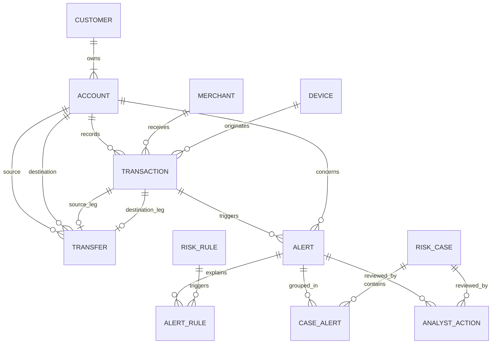

# Entity relationships and lifecycle

`AlertRule` and `CaseAlert` are explicit bridge tables for their many-to-many
relationships. Each transfer has exactly one source debit and one destination
credit, with unique transaction IDs in the transfer table. A transaction can
appear in at most one transfer leg of each kind.

## Cardinality and optionality

- Customer to Account is 1:N; every account has exactly one customer.
- Account to Transaction, Merchant to Transaction, and Device to Transaction
  are each 1:N; every baseline transaction has one of each parent.
- Account to Transfer has two role-specific 1:N relationships. Every transfer
  has one source and one destination account, and the accounts must differ.
- Transaction to Transfer has two role-specific 1:1 relationships; both legs
  are required.
- Transaction and Account to Alert are each 1:N; every baseline alert refers to
  one transaction and its account.
- Alert to RiskRule is N:M through AlertRule.
- RiskCase to Alert is N:M through CaseAlert.
- AnalystAction may refer to an alert, a case, or both. Generated actions link
  both; runtime actions validate the selected target.
- AuditEvent has a typed polymorphic entity reference because it records
  immutable history for more than one entity kind.

## Effective dates and lifecycle

All transaction, alert, case, analyst-action, and audit timestamps are UTC.
Account activity cannot precede `openedAt`; each account's running balance is
validated chronologically from `initialBalance`. A case cannot predate any
linked alert. Analyst dispositions cannot predate their target alert/case.
Resolved cases require a `resolvedAt` timestamp and reopening clears it.

Customer KYC status is stored on the customer record. Account, alert, case, and
transaction status enums are documented in the [data dictionary](data-dictionary.md)
and enforced by the Prisma schema where available.
